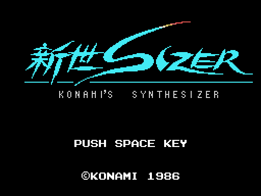
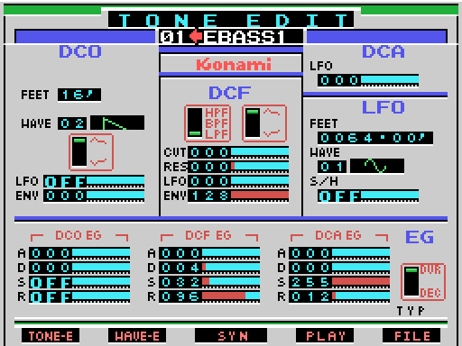
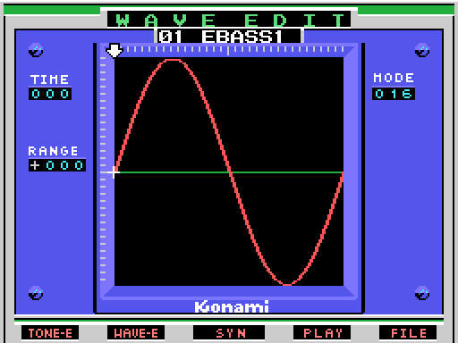
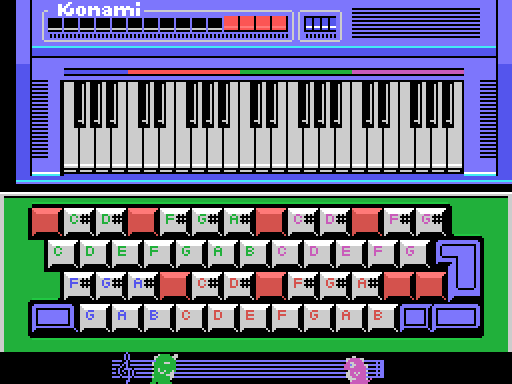
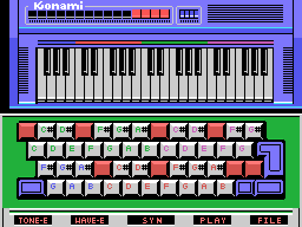
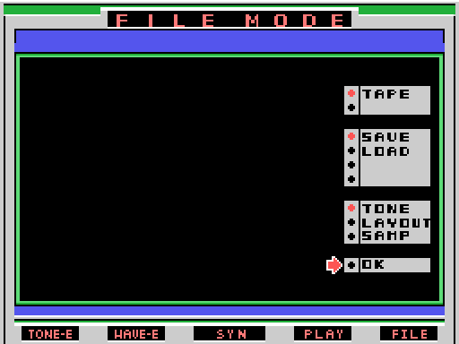
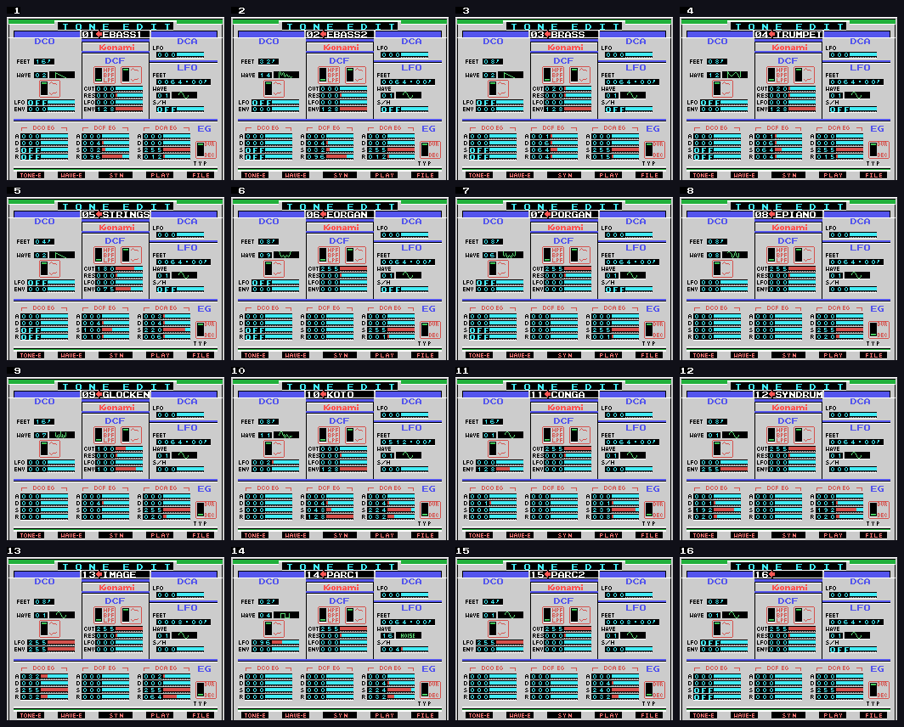
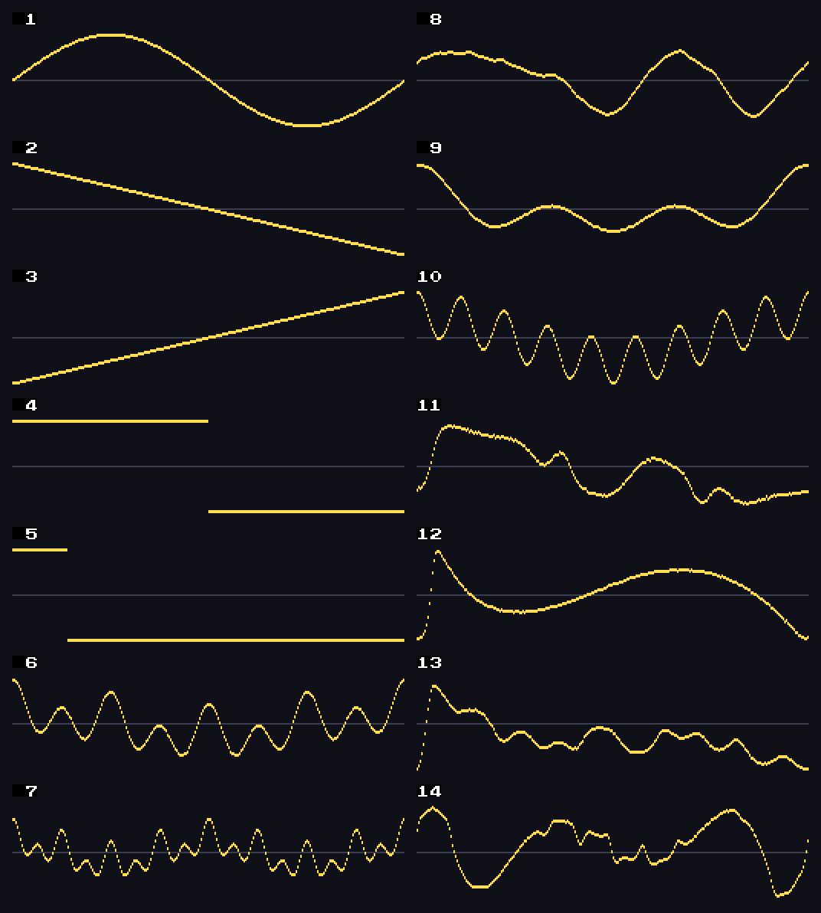

# The program

*Konami's Synthesizer* is not a game: it is a synthesizer. The cartridge
carries an 8-bit digital-to-analogue converter that sounds with every byte
the Z80 writes to `0x4000`, and the program is a subtractive synthesizer
(oscillator, filter, amplifier, three envelopes and an LFO) that **computes
the note sample by sample** in the computer's RAM and then plays it through
that converter. Everything that sounds, the Z80 does.

At power-on the Konami logo is uncovered line by line, the 新世SIZER is
painted in seven passes, one byte in every eight on each, and the title waits
for SPACE. If it does not come, the intro shows one of the program's four
screens for 512 frames (`0xBE5E`) and starts again.

## The screens

Five function keys, and four more with SHIFT (`0x4877`):

| key | screen |
|---|---|
| F1 | TONE EDIT: the 29 fields of the tone |
| F2 | WAVE EDIT: draw a wave by hand |
| F3 | SYN: synthesize the tone |
| F4 | PLAY: play |
| F5 | FILE: the tape |
| SHIFT F1 | copy a tone, with its wave, onto another |
| SHIFT F2 | the list of the sixteen tones |
| SHIFT F3 | the printer |
| SHIFT F4 | LAYOUT: which note each key gives |

**TONE EDIT** (`0xA5AA`) edits the tone's 25 parameters and its name. The
oscillator (DCO) picks one of the fourteen waves in the ROM, the user's one
or noise, and its pitch in feet; the filter (DCF) has cutoff, resonance from
0 to 8 and three outputs, high-pass, band-pass and low-pass; the amplifier
(DCA) has its envelope, and each of the three envelopes is ADSR. The LFO can
move the oscillator, the filter and the amplifier, with its own wave and,
with S/H, with sampled noise. The cursor keys move from field to field, INS
and DEL go up and down, and the digits type the value.

**WAVE EDIT** (`0xADF7`) draws wave 15, the user's, by hand: 256 signed
samples, one dot per sample. The sixteen user waves (one per tone) start out
as wave 1, a sine (`0x55CF`). Left and right move the cursor step by step
(MODE, which SELECT changes), up and down change the sample, and the stretch
between the cursor and its previous step is filled in a straight line
(`0xB236`). A key of the music keyboard plays it; CTRL and HOME zero it.

**SYN** (`0x55F0`) is the synthesizer: it computes the whole note, sample by
sample, in the 16 KB from `0x8000` to `0xBFFF`, with the screen stopped and
interrupts disabled. How long it lasts is computed from the envelopes
(`0x5613`), and while it works a cursor moves across the screen and, every 16
ticks, two tiles of the drawing change (`0x4BD9`). When it finishes it jumps
to PLAY; F1, F2, F4 and F5 cut it short (`0x5767`).

**PLAY** (`0x5D3A`) plays with the MSX keyboard as if it were a piano: the
four rows of letters and digits are 48 keys, white and black, with each
key's note written above it according to the LAYOUT; the factory one gives a
note to 40 (`0x4B71`). **One key sounds at a time**: the program reads the
sample and sends it to the DAC byte by byte, and the pitch is set by how long
it waits between bytes ([Findings](FINDINGS.md)). With the tone's EG TYP on
DEC, the note is sustained while the key is held by repeating one page of the
sample, and on release it goes on to the end; on DUR it plays through in one
go.

**FILE** (`0xB5DB`) saves to and loads from tape three kinds of file: TONE
(the sixteen tones with their sixteen waves, 4,608 bytes), LAYOUT (176 bytes)
and SAMP (the synthesized sample, up to 16 KB, with its loop page). The
format is in [The code](THE-CODE.md). The tape that came with the cartridge
carries seven SAMPs on its two sides: PIANO, BRASS and ORCHE of 16,384 bytes,
TRUMPET of 12,288, SAMISEN of 7,792, DOG of 3,072 and CRASH of 16,384.

## The sixteen factory tones

They are in the ROM, at `0xA3AA`, 32 bytes each: 25 parameters and the name.
This is how TONE EDIT shows them (the ADSRs as attack/decay/sustain/release,
the filter with its output, `-` if the filter's envelope subtracts and `i` if
the oscillator's is inverted):

| n | name | wave | FEET | LFO DCO | ENV DCO | CUT | RES | LFO DCF | ENV DCF | LFO DCA | ADSR DCO | ADSR DCF | ADSR DCA | S/H | LFO wave | LFO FEET | filter | EG |
|---|---|---|---|---|---|---|---|---|---|---|---|---|---|---|---|---|---|---|
| 1 | EBASS1 | 2 | 16' | 0 | 0 | 0 | 0 | 0 | 128 | 0 | 0/0/0/0 | 0/4/32/96 | 0/0/255/12 | 0 | 1 | 64.00' | LPF | DEC |
| 2 | EBASS2 | 14 | 32' | 0 | 0 | 0 | 0 | 0 | 128 | 0 | 0/0/0/0 | 0/4/32/96 | 0/0/255/12 | 0 | 1 | 64.00' | LPF | DEC |
| 3 | BRASS | 2 | 8' | 0 | 0 | 20 | 0 | 0 | 128 | 0 | 0/0/0/0 | 1/6/64/4 | 0/0/255/15 | 0 | 1 | 64.00' | LPF | DEC |
| 4 | TRUMPET | 12 | 8' | 0 | 0 | 20 | 0 | 0 | 128 | 0 | 0/0/0/0 | 1/6/64/4 | 0/0/255/15 | 0 | 1 | 64.00' | LPF | DEC |
| 5 | STRINGS | 2 | 4' | 0 | 0 | 180 | 0 | 0 | 75 | 0 | 0/0/0/0 | 0/4/100/10 | 3/4/220/6 | 0 | 1 | 64.00' | LPF | DEC |
| 6 | EORGAN | 9 | 8' | 0 | 0 | 255 | 0 | 0 | 0 | 0 | 0/0/0/0 | 0/0/0/0 | 0/0/255/1 | 0 | 1 | 64.00' | LPF | DEC |
| 7 | PORGAN | 6 | 8' | 0 | 0 | 255 | 0 | 0 | 0 | 0 | 0/0/0/0 | 0/0/0/0 | 0/0/255/1 | 0 | 1 | 64.00' | LPF | DEC |
| 8 | EPIANO | 8 | 8' | 0 | 0 | 255 | 0 | 0 | 0 | 0 | 0/0/0/0 | 0/0/0/0 | 0/0/255/20 | 0 | 1 | 64.00' | LPF | DUR |
| 9 | GLOCKEN | 7 | 16' | 0 | 0 | 100 | 0 | 0 | 100 | 0 | 0/0/0/0 | 0/4/0/0 | 0/0/255/20 | 0 | 1 | 64.00' | LPF | DUR |
| 10 | KOTO | 11 | 8' | 2 | 0 | 0 | 0 | 0 | 128 | 0 | 0/0/0/0 | 0/4/48/128 | 0/4/224/32 | 0 | 1 | 512.00' | LPF | DUR |
| 11 | CONGA | 1 | 16' | 0 | 128 | 255 | 0 | 0 | 0 | 0 | 0/1/0/0 | 0/0/0/0 | 0/1/239/8 | 0 | 1 | 64.00' | LPF | DUR |
| 12 | SYNDRUM | 1 | 8' | 0 | 255 | 255 | 0 | 0 | 0 | 0 | 0/1/192/20 | 0/0/0/0 | 0/1/192/20 | 0 | 1 | 64.00' | LPF | DUR |
| 13 | IMAGE | 1 | 8' | 255 | 255 | 255 | 0 | 0 | 0 | 0 | 32/0/255/32 | 0/0/0/0 | 2/0/255/64 | 0 | 1 | 8.00' | LPF | DUR |
| 14 | PARC1 | 4 | 2' | 96 | 0 | 255 | 0 | 0 | 0 | 0 | 0/0/0/0 | 0/0/0/0 | 0/4/224/32 | 4 | S/H | 64.00' | LPF | DUR |
| 15 | PARC2 | 1 | 4' | 255 | 0 | 255 | 0 | 0 | 0 | 0 | 0/0/0/0 | 0/0/0/0 | 0/4/240/32 | 0 | 1 | 8.00' | LPF | DUR |
| 16 | (no name) | 1 | 8' | 0 | 0 | 255 | 0 | 0 | 0 | 0 | 0/0/0/0 | 0/0/0/0 | 0/0/255/0 | 0 | 1 | 64.00' | LPF | DEC |

And this is how they sound, synthesized with `tools/motor.py` and played
with `tools/sonido.py` at A3 with the key held for a second. They are the
bytes the cartridge sends to the DAC: tone 1 is checked against openMSX,
22,273 bytes and 0 different ([In the emulator](IN-THE-EMULATOR.md)).

| tone | | tone | |
|---|---|---|---|
| 1 EBASS1 | [timbre-01.wav](sonido/timbre-01.wav) | 9 GLOCKEN | [timbre-09.wav](sonido/timbre-09.wav) |
| 2 EBASS2 | [timbre-02.wav](sonido/timbre-02.wav) | 10 KOTO | [timbre-10.wav](sonido/timbre-10.wav) |
| 3 BRASS | [timbre-03.wav](sonido/timbre-03.wav) | 11 CONGA | [timbre-11.wav](sonido/timbre-11.wav) |
| 4 TRUMPET | [timbre-04.wav](sonido/timbre-04.wav) | 12 SYNDRUM | [timbre-12.wav](sonido/timbre-12.wav) |
| 5 STRINGS | [timbre-05.wav](sonido/timbre-05.wav) | 13 IMAGE | [timbre-13.wav](sonido/timbre-13.wav) |
| 6 EORGAN | [timbre-06.wav](sonido/timbre-06.wav) | 14 PARC1 | [timbre-14.wav](sonido/timbre-14.wav) |
| 7 PORGAN | [timbre-07.wav](sonido/timbre-07.wav) | 15 PARC2 | [timbre-15.wav](sonido/timbre-15.wav) |
| 8 EPIANO | [timbre-08.wav](sonido/timbre-08.wav) | 16 (no name) | [timbre-16.wav](sonido/timbre-16.wav) |

## The fourteen waves

The oscillator reads one of the fourteen waves at `0x7200`, 256 signed
samples each, in page `0x72` + wave (`0x56FF`). Wave 1 is the sine the user
waves start out as; 15 is the user's, and 16 is noise, which is not a table:
it comes from reading the BIOS ([Findings](FINDINGS.md)).

